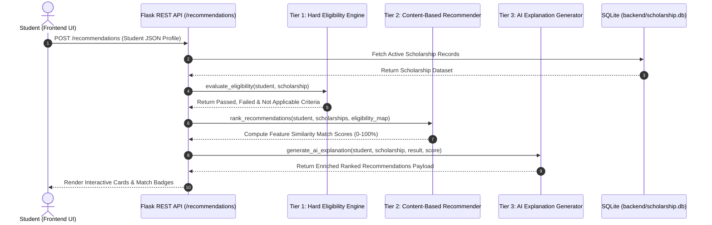

# AI Scholarship Finder — AI-Assisted Content-Based Recommendation System

> **College Academic Project Presentation**  
> *An AI-assisted content-based scholarship recommendation system that combines scholarship-specific eligibility filtering with explainable weighted recommendation scoring.*

---

## 1. Project Title
**AI Scholarship Finder — Profile-Based Matching & Recommendation Platform**

---

## 2. Problem Statement
Millions of students across India miss out on government and private scholarship opportunities due to:
- **Fragmented Discovery**: Information is scattered across National Scholarship Portal (NSP), AICTE, state government welfare boards, and private trusts.
- **Complex & Multivariate Criteria**: Requirements involve multi-variable constraints (academic metrics, family income ceilings, state domicile, category reservations, age limits, and discipline requirements).
- **Lack of Transparency**: Traditional keyword search engines fail to explain *why* a student qualifies or fails eligibility, leading to wasted application efforts.

---

## 3. Objective
To construct a robust 2-tier recommendation platform that guarantees **deterministic hard eligibility verification** while leveraging **content-based feature vector similarity scoring** to rank and explain candidate scholarship fits without hallucinating eligibility.

---

## 4. Key Features
- **2-Tier Hybrid Architecture**: Combines rule-based hard eligibility filtering with content-based feature vector ranking.
- **Dynamic Academic Score Model**: Supports Percentage (%), CGPA (out of 10.0), and Marks (obtained vs maximum) without invalid automatic conversions.
- **Optional & Not Applicable Criteria Logic**: Missing or open scholarship constraints (State='All', Category='All', Gender='All', Income=NULL, Age=NULL) are treated as *Not Applicable* without penalizing eligibility or recommendation scores.
- **Personalized & Transparent Explanations**: Generates profile-specific, natural language bullet points detailing passed, failed, and not-applicable criteria.
- **Independent Benchmark Evaluation Framework**: Evaluates precision, recall, top-K accuracy, and MRR against manually curated independent ground-truth profiles.
- **Admin Scholarship Management Subsystem**: Enables authorized administrators to view, add, edit, and delete scholarship listings securely.

---

## 5. System Architecture

```mermaid
flowchart TD
    A[Student Profile Input UI] --> B[Data Preprocessing & Validation]
    B --> C[Tier 1: Deterministic Hard Eligibility Engine]
    
    subgraph Tier 1: Hard Eligibility Engine
        C --> D1{1. Education Level}
        D1 --> D2{2. Course Field}
        D2 --> D3{3. Academic Score Type & Score}
        D3 --> D4{4. Income Ceiling}
        D4 --> D5{5. State Domicile}
        D5 --> D6{6. Category Reservation}
        D6 --> D7{7. Gender Restriction}
        D7 --> D8{8. Age Limit (Optional)}
    end

    D8 --> E[Candidate Eligibility Matrix]
    
    E --> F[Tier 2: Content-Based Weighted AI Recommender]
    
    subgraph Tier 2: AI Recommender Engine (0-100 Points)
        F --> G1[Academic Margin Fit: 30 pts]
        F --> G2[Financial Need Gradient: 25 pts]
        F --> G3[Discipline & Education Fit: 20 pts]
        F --> G4[Regional Domicile Alignment: 15 pts]
        F --> G5[Category & Demographic Fit: 10 pts]
        G1 & G2 & G3 & G4 & G5 --> H[Normalized AI Match Score 0-100%]
    end

    H --> I[Tier 3: Personalized AI Explanation Generator]
    I --> J[Scholarship Results Dashboard UI]
```

### Flow Sequence


---

## 6. Modules
1. **Flask REST API Core (`backend/app.py`)**: Manages backend routing, database initialization, CORS, and admin operations.
2. **Hard Eligibility Engine (`backend/eligibility_engine.py`)**: Executes deterministic rule verification in fixed order (Education, Course, Academics, Income, State, Category, Gender, Age).
3. **Content-Based Recommender (`backend/recommender.py`)**: Computes 0–100 AI match scores based on feature vector alignment without penalizing Not Applicable criteria.
4. **AI Explanation Generator (`backend/ai_explanation.py`)**: Produces human-readable, profile-specific natural language explanations.
5. **Independent Benchmark Evaluator (`backend/evaluator.py`)**: Measures Precision@K, Recall@K, Top-K Accuracy, and MRR.
6. **Frontend Web Interface (`frontend/`)**: Modern responsive UI supporting dynamic input toggles, dashboard sorting, filters, search, and admin management.

---

## 7. Student Profile Schema
- `id`: Unique identifier (INTEGER PRIMARY KEY)
- `name`: Student full name (TEXT)
- `education`: Education level e.g. School, Undergraduate, Postgraduate (TEXT)
- `academic_score_type`: Percentage, CGPA, or Marks (TEXT)
- `academic_score`: Numeric score value (REAL)
- `obtained_marks`: Obtained marks if Marks selected (REAL)
- `max_marks`: Maximum marks if Marks selected (REAL)
- `marks`: Normalized percentage / legacy score (REAL)
- `family_income`: Annual family income in INR (REAL)
- `state`: Domicile state (TEXT)
- `category`: Reservation category e.g. General, OBC, SC, ST, EWS (TEXT)
- `age`: Student age (INTEGER, Optional)
- `gender`: Gender e.g. Female, Male, Other (TEXT)
- `course`: Discipline / Course field (TEXT)
- `created_at`: Timestamp (TIMESTAMP)

---

## 8. Scholarship Dataset
Seeded with 11 verified official schemes from AICTE, National Scholarship Portal (NSP), Directorate of Technical Education (Tamil Nadu), and private trusts:
1. **AICTE Pragati Scholarship for Girl Students** (₹50,000/yr, AICTE) — `https://www.aicte-india.org`
2. **AICTE Saksham Scholarship Scheme for Specially Abled** (₹50,000/yr, AICTE) — `https://www.aicte-india.org`
3. **AICTE Swanath Scholarship Scheme** (₹50,000/yr, AICTE) — `https://www.aicte-india.org`
4. **PM-USP Central Sector Scheme of Scholarships** (₹12,000–₹20,000/yr, NSP) — `https://scholarships.gov.in`
5. **PM YASASVI Post-Matric Scholarship** (₹20,000/yr, NTA) — `https://yet.nta.ac.in`
6. **Post Matric Scholarships Scheme for SC Students** (Full tuition + Allowance, NSP) — `https://scholarships.gov.in`
7. **Tamil Nadu Govt First Generation Graduate Fee Waiver** (Tuition Waiver, TN DOTE) — `https://tndce.tn.gov.in`
8. **Tamil Nadu Pudhumai Penn Scheme (Moovalur Ramamirtham)** (₹1,000/mo, TN Social Welfare) — `https://penkalvi.tn.gov.in`
9. **Reliance Foundation Undergraduate Scholarship** (Up to ₹2,00,000, Reliance Foundation) — `https://www.scholarships.reliancefoundation.org`
10. **Kotak Kanya Scholarship for Girl Students** (Up to ₹1,50,000/yr, Kotak Foundation) — `https://kotakeducation.org`
11. **HDFC Bank Parivartan's ECSS Programme** (Up to ₹50,000, HDFC Bank) — `https://www.hdfcbank.com`

---

## 9. Eligibility Engine Logic
The eligibility engine evaluates candidate scholarships using a strict 8-step deterministic pipeline:
1. **Education Level Check**: Evaluates level match (e.g. Undergraduate vs Undergraduate). Unspecified levels match all.
2. **Course Field Check**: Matches exact course or engineering discipline overlap.
3. **Dynamic Academic Score Check**: Evaluates compatible score types (Percentage vs Percentage, CGPA vs CGPA, Marks vs Marks / calculated percentage). Flagged as incompatible if score types differ without conversion.
4. **Family Income Check**: Verifies `student_income <= maximum_income`. Unspecified income ceilings are categorized as Not Applicable.
5. **State Domicile Check**: Verifies state match. State='All' is categorized as Not Applicable.
6. **Category Reservation Check**: Verifies reservation category. Category='All' is Not Applicable.
7. **Gender Restriction Check**: Verifies gender match. Gender='All' is Not Applicable.
8. **Age Limit Check (Optional)**: Evaluates `student_age <= age_limit` only if `age_limit` is explicitly specified by the scholarship.

A scholarship is marked **Eligible** if and only if `failed_criteria` is empty.

---

## 10. Academic Score Handling
- **Percentage (%)**: Compared directly against Percentage requirements.
- **CGPA**: Compared directly against CGPA minimum requirements (e.g., Student CGPA 8.5 vs Required CGPA 7.5). **Does NOT convert 8.5 CGPA to 85% automatically.**
- **Marks**: Accepts Obtained Marks and Maximum Marks (e.g., 450 / 500 = 90.0%). Evaluates obtained marks or calculates percentage when compatible.
- **Incompatible Score Types**: If a scholarship requires CGPA and the student provided Percentage (or vice versa), the system flags the criterion without performing unverified mathematical assumptions.

---

## 11. Recommendation Algorithm
Computes an **AI Match Score (0–100%)** using a weighted feature vector model:
- **Academic Performance & Margin Fit (30 Points)**: Base credit (22 pts) for satisfying requirement + margin bonus (up to 8 pts) for higher GPA/marks.
- **Financial Need & Income Gradient (25 Points)**: Base credit (18 pts) + need priority bonus (up to 7 pts) for lower relative family income.
- **Education & Course Alignment (20 Points)**: Level match (10 pts) + Discipline overlap (10 pts).
- **State & Regional Alignment (15 Points)**: Specific state match or All-India scheme (15 pts).
- **Category & Demographic Alignment (10 Points)**: Category fit (6 pts) + Gender fit (4 pts).

*Crucial Rule*: Unspecified/Not Applicable criteria receive full fit credit so students are never penalized for criteria a scholarship does not restrict.

---

## 12. Explainability
Every recommendation is accompanied by transparent natural language explanations detailing:
- **Eligibility Status**: Hard Eligible vs Ineligible.
- **Passed Criteria List**: Bullet points confirming satisfied rules (e.g. `Education level (Undergraduate) satisfies requirement`).
- **Failed Criteria List**: Explanations for unmet constraints (e.g. `Family income (₹600,000) exceeds maximum limit (₹450,000)`).
- **Not Applicable List**: Explanations for unspecified rules (e.g. `Age limit: Not Applicable (No age restriction specified)`).

---

## 13. Evaluation Methodology
Evaluation is performed offline using **5 realistic benchmark test profiles** with **manually curated independent ground-truth relevant scholarship IDs** (not generated by the recommendation algorithm itself).

---

## 14. Evaluation Metrics & Benchmark Results
Benchmark results evaluated via `python backend/evaluator.py`:

| Metric | Measured Value | Description |
| :--- | :--- | :--- |
| **Precision@3** | **86.7%** | Proportion of top-3 recommended items that are ground-truth relevant. |
| **Recall@3** | **68.3%** | Proportion of total ground-truth relevant schemes retrieved in top-3. |
| **Precision@5** | **56.0%** | Proportion of top-5 recommended items that are ground-truth relevant. |
| **Recall@5** | **75.0%** | Proportion of total ground-truth relevant schemes retrieved in top-5. |
| **Top-3 Accuracy** | **100.0%** | % of test profiles with at least 1 relevant recommendation in top-3. |
| **Top-5 Accuracy** | **100.0%** | % of test profiles with at least 1 relevant recommendation in top-5. |
| **MRR** | **1.000** | Mean Reciprocal Rank of the first relevant recommendation across queries. |

### Metric Formulas
$$\text{Precision}@K = \frac{|\text{Top-}K \cap \text{Ground Truth Relevant}|}{K}$$

$$\text{Recall}@K = \frac{|\text{Top-}K \cap \text{Ground Truth Relevant}|}{|\text{Ground Truth Relevant}|}$$

$$\text{MRR} = \frac{1}{|Q|} \sum_{i=1}^{|Q|} \frac{1}{\text{rank}_i}$$

---

## 15. Technologies Used
- **Backend Framework**: Python 3.14, Flask, Flask-CORS
- **Database**: SQLite3 (`backend/scholarship.db`)
- **Frontend Architecture**: HTML5, Vanilla JavaScript (ES6+), Vanilla CSS3 (Custom Design System with Design Tokens)
- **Typography**: Google Fonts (Sora for headings, Inter for body)

---

## 16. Database Design
Located at `backend/scholarship.db`.

### `students` Table Schema
```sql
CREATE TABLE students (
    id INTEGER PRIMARY KEY AUTOINCREMENT,
    name TEXT NOT NULL,
    education TEXT NOT NULL,
    marks REAL NOT NULL,
    academic_score_type TEXT DEFAULT 'Percentage',
    academic_score REAL,
    obtained_marks REAL,
    max_marks REAL,
    family_income REAL NOT NULL,
    state TEXT NOT NULL,
    category TEXT NOT NULL,
    age INTEGER,
    gender TEXT,
    course TEXT,
    created_at TIMESTAMP DEFAULT CURRENT_TIMESTAMP
);
```

### `scholarships` Table Schema
```sql
CREATE TABLE scholarships (
    id INTEGER PRIMARY KEY AUTOINCREMENT,
    name TEXT NOT NULL,
    provider TEXT NOT NULL,
    description TEXT,
    amount REAL,
    minimum_marks REAL,
    academic_requirement_type TEXT DEFAULT 'Percentage',
    minimum_academic_score REAL,
    maximum_income REAL,
    education TEXT,
    state TEXT,
    category TEXT,
    course TEXT DEFAULT 'All',
    gender TEXT DEFAULT 'All',
    age_limit INTEGER DEFAULT NULL,
    deadline TEXT,
    application_url TEXT
);
```

---

## 17. API Endpoints

### Student & Recommendation Endpoints
- `GET /`: Health check & API status.
- `GET /scholarships`: Retrieves all active scholarship listings.
- `POST /students`: Saves a new student profile to database.
- `POST /recommendations`: Runs student profile through 2-tier pipeline and returns ranked recommendations.
- `GET /evaluate`: Triggers offline benchmark evaluator and returns evaluation metrics JSON.

### Admin Management Endpoints (Requires Header `X-Admin-Key: admin123`)
- `GET /admin/scholarships`: Fetch all scholarship listings for admin view.
- `POST /admin/scholarships`: Create a new scholarship entry.
- `PUT /admin/scholarships/<id>`: Update an existing scholarship entry.
- `DELETE /admin/scholarships/<id>`: Delete a scholarship entry.

---

## 18. How to Run

### 1. Start Flask Backend
```bash
cd backend
python app.py
```
*Backend server runs on `http://127.0.0.1:5000`*

### 2. Launch Frontend Interface
Open `frontend/index.html` in your web browser or serve using Python:
```bash
cd frontend
python -m http.server 5500
```
*Frontend interface runs on `http://127.0.0.1:5500`*

---

## 19. Testing

### Run Benchmark Evaluator
```bash
python backend/evaluator.py
```

### Run Edge Case Test Suite
```bash
python scratch/test_edge_cases.py
```
*Tests 15 edge cases including school profiles, CGPA, marks, optional age, missing income limits, course mismatches, high income, and zero eligible scenarios.*

---

## 20. Limitations
- **Dataset Size**: Currently seeded with 11 verified national & state schemes.
- **Manual Data Updates**: Deadline updates require admin interface entry or manual database edits.

---

## 21. Future Scope
- **Automated Web Scraping**: Integrate BeautifulSoup / Selenium pipeline to auto-crawl NSP and state portals for deadline updates.
- **LLM Application Essay Assistant**: Optionally connect Gemini API to generate personalized scholarship application cover letters.
- **OCR Certificate Verification**: Automatically parse marksheets and income certificates using Tesseract OCR.
